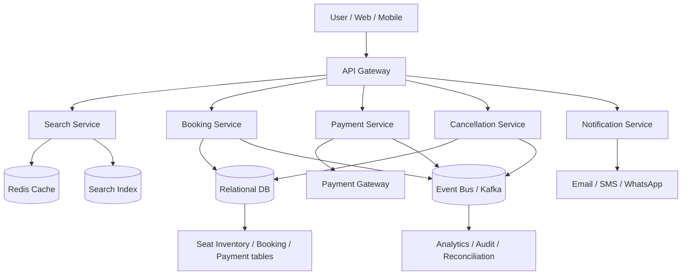
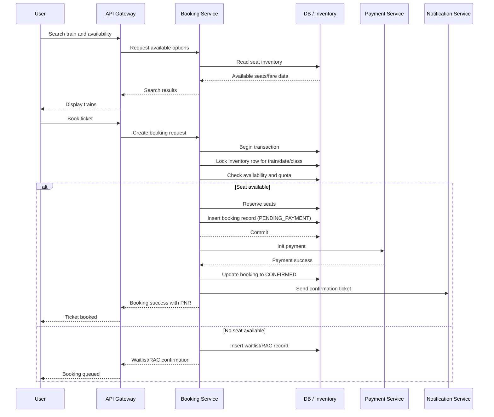

# High-Level Design: Train Ticket Booking System (IRCTC-like)

## 1. Objective
Design a highly scalable, highly reliable train ticket booking system that supports:

- Train search and seat availability
- Ticket booking and cancellation
- Payment processing and refunds
- Waitlist management
- Concurrent booking without double-booking
- Peak-time scaling for Tatkal and festive traffic

---

## 2. Functional Requirements

- Search trains by source, destination, date, class, and quota
- View available seats, fare, and journey details
- Book tickets for one or more passengers
- Handle confirmed, RAC, and waitlist statuses
- Allow cancellation of confirmed or waitlisted tickets
- Process payments securely and initiate refunds
- Generate PNR and booking confirmation
- Show booking history and status for users

---

## 3. Non-Functional Requirements

- Low latency for search and booking operations
- High availability during peak traffic
- Consistency for seat allocation and payment state
- Horizontal scalability for millions of concurrent requests
- Security for user and payment data
- Auditability for refunds, cancellations, and bookings

---

## 4. High-Level Architecture

### Main components

- API Gateway: handles routing, auth, throttling, and request limits
- Search Service: fetches trains and seat availability
- Booking Service: validates requests, reserves seats, creates PNR
- Payment Service: initiates payment, handles capture and refunds
- Cancellation Service: processes cancellations and refunds
- Notification Service: sends booking, cancellation, and refund updates
- Relational DB: system of record for bookings, payments, and inventory
- Redis: caches hot routes, fares, and availability data
- Kafka/Event Bus: asynchronous tasks such as notifications and auditing

---

## 5. Core Design

### 5.1 Search Service
Responsibilities:

- Search trains for a route + date
- Apply filters like class, quota, train type, departure time
- Show seat availability and fare
- Support high-volume read queries

Design decisions:

- Use a denormalized read model for frequent searches
- Cache popular routes in Redis
- Use a search index for faster train and schedule lookup
- Keep stock counts at train/date/class granularity

### 5.2 Booking Service
Responsibilities:

- Validate user and train availability
- Check quota and class availability
- Reserve seats atomically
- Create booking record with PNR
- Trigger payment initiation

Booking lifecycle:

- SEARCHED
- SELECTED
- PENDING_PAYMENT
- CONFIRMED
- WAITLISTED
- RAC
- CANCELLED
- FAILED

### 5.3 Payment Service
Responsibilities:

- Secure payment authorization and capture
- Handle payment retries and idempotency
- Process refunds for cancellations
- Reconcile payment gateway callbacks

Important design rule:

- Payment must be idempotent per booking request
- Use a unique request ID / payment ID to prevent duplicate charges

### 5.4 Cancellation Service
Responsibilities:

- Cancel tickets safely
- Release seat inventory immediately
- Determine refund amount using fare rules
- Promote waitlisted passengers if applicable

---

## 6. Seat Inventory Model

Seat inventory is tracked by:

- Train ID
- Travel Date
- Class Type
- Quota Type
- Total Seats
- Available Confirmed Seats
- Available RAC Seats
- Available Waitlist Seats
- Booking Locks / Version Number

Example record:

- train_id: 12859
- travel_date: 2026-10-30
- class: AC 3 Tier
- quota: General
- total_seats: 72
- available_confirmed: 18
- available_rac: 8
- available_waitlist: 15
- version: 245

---

## 7. Booking Flow

---

## 8. Concurrency and Double-Booking Prevention

This is the most critical issue in any booking system.

### Recommended strategy
Use transactional inventory locking:

- Start DB transaction
- Lock the inventory row for train/date/class
- Check available seats
- Reserve or queue the booking
- Commit transaction

### Why it works
Two parallel bookings for the same train/date/class will compete for the same inventory row. Only one transaction is allowed to reserve the seat; the others either:

- get waitlist status, or
- fail with no seat available, or
- move to RAC if enabled

### Locking methods

- Pessimistic locking: SELECT ... FOR UPDATE
- Optimistic locking: use version numbers and retry on conflict
- Partition inventory rows by train/date/class to reduce contention

### Best practice
Keep transaction duration short and avoid long waits during lock acquisition. The booking transaction should not hold locks across slow external calls such as payment gateway calls.

---

## 9. Waitlist Management

Waitlist logic should be deterministic and fair.

- Maintain queue per train/date/class/quota
- Insert in order of booking time
- Promote next passenger automatically when a cancel/void occurs
- Update booking status from WAITLISTED to CONFIRMED when promoted

### Example queue behavior

- Passenger A waitlisted at time T1
- Passenger B waitlisted at time T2
- Passenger C cancels confirmed seat
- System promotes A first, then B if another seat opens

---

## 10. Payment and Refund Workflow

### Payment flow

1. Booking service creates pending booking
2. Payment service verifies payment request and user account
3. Gateway authorizes payment
4. Booking is marked CONFIRMED only after successful capture
5. Event is published for notifications and analytics

### Refund flow

1. User requests cancellation
2. Cancellation Service validates eligibility
3. Refund amount computed by fare rules
4. Payment Service initiates refund to original source
5. Booking status updated to CANCELLED
6. Waitlist promotions can be triggered if needed

### Key rule
Refund and cancellation must be idempotent to avoid double refunding the same booking.

---

## 11. Scalability During Peak Traffic (Tatkal / Festival surge)

### Challenges

- Huge spike in booking requests in a short window
- Search traffic and booking traffic rise simultaneously
- Inventory quickly becomes exhausted
- Payment gateways may experience latency spikes

### Scalability patterns

- Horizontal scaling of application servers behind a load balancer
- Read-heavy caching with Redis for search and fare data
- Database sharding or partitioning by train/date/region
- Rate limiting and request throttling for abusive traffic
- Priority handling for Tatkal bookings and authenticated users
- Queue-based processing for non-critical notifications and analytics
- Dedicated inventory pools for special quotas

### Recommended peak strategy

- Pre-warm popular routes and fares in cache
- Rate-limit repeated booking attempts from the same user/IP
- Use admission control when system is overloaded
- Preserve fairness by queueing requests instead of allowing unlimited retries

---

## 12. Reliability and Fault Tolerance

- Use retry and backoff for transient database and payment gateway failures
- Maintain outbox tables to ensure events are not lost
- Use dead-letter queues for failed asynchronous tasks
- Run multiple app instances across availability zones
- Reconciliation jobs to fix mismatches between DB, payment records, and inventory

---

## 13. Security

- JWT or OAuth-based authentication
- Encrypted storage for payment and passenger data
- PCI-safe payment handling through payment gateway tokenization
- Strict role-based access for admin and operations teams
- Audit logs for refunds, cancellations, and inventory updates

---

## 14. Data Model (Logical)

### Entities

- User
- Train
- Route
- Schedule
- SeatInventory
- Booking
- Passenger
- Payment
- Refund
- PNR
- WaitlistEntry
- CancellationLog
- AuditLog

### Relationships

- A User can have many Bookings
- A Train has many Routes and Schedules
- A Booking contains many Passengers
- A Booking maps to one Payment and optional Refund
- Inventory is tracked per Train + Date + Class + Quota

---

## 15. Example Flow of Data

- Search query -> Search Service -> Redis / Search Index
- Booking request -> Booking Service -> Inventory DB
- Payment success -> Payment Service -> Booking update -> Notification event
- Cancellation -> Cancellation Service -> Inventory release -> Refund processing

---

## 16. Trade-offs

### Strong consistency vs scalability
- Strong consistency protects against double-booking
- But it can reduce throughput if overused at the wrong layer
- Best practice: use strong consistency only where it matters most: inventory and booking state

### Cache vs freshness
- Caching improves search latency
- But stale data can show outdated availability
- Use short TTL, invalidation on booking events, and final live checks during booking

### Synchronous vs async
- Synchronous payment confirmation is better for user experience
- Asynchronous notifications and analytics are safer for system performance

---

## 17. Final Summary

This system should be built around a transactional inventory model, a reliable booking engine, and a scalable search/read layer. The main challenge is preventing double-booking during concurrent requests, especially during peak periods like Tatkal. The right approach is to keep the source of truth in the database, use short transactional locks for reservations, and use Redis + event-driven architecture for speed and scale.

This design ensures:

- accurate seat allocation
- strong concurrency safety
- quick ticket searches
- reliable payment and refunds
- operational resilience during peak demand

---

## 18. Optional next step

If needed, I can also convert this into:

- a one-page interview-style answer
- a more formal HLD document with assumptions and APIs
- a diagram in PNG/SVG format
- a sequence diagram plus ER diagram version
